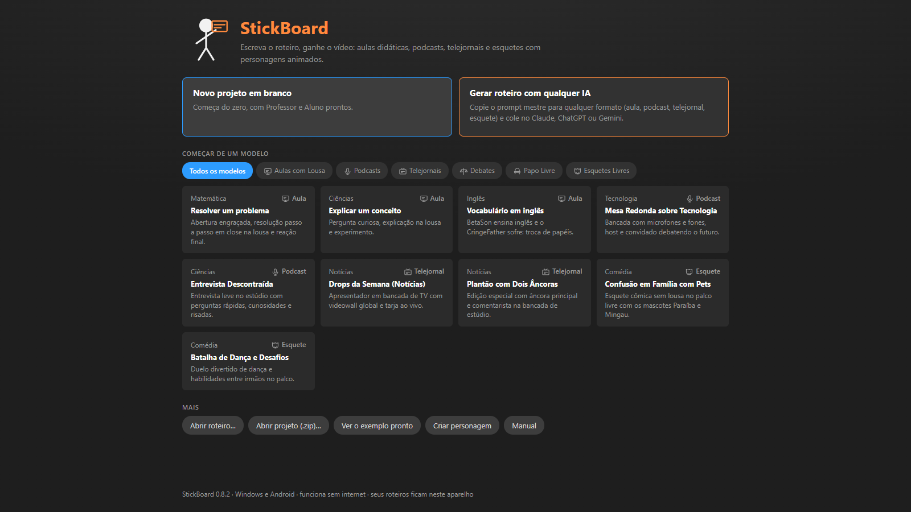
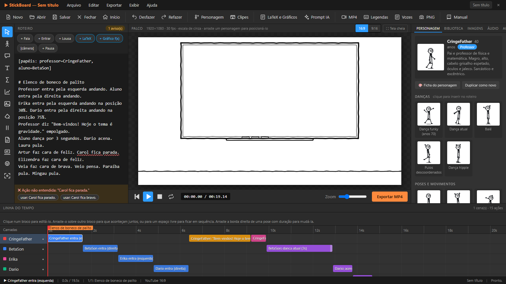
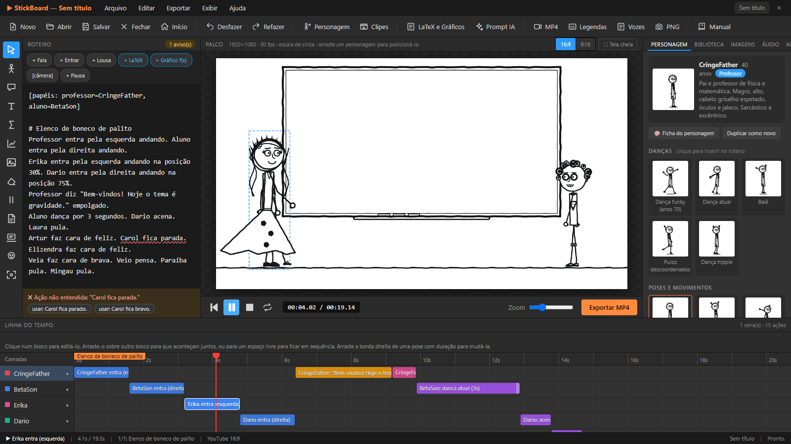
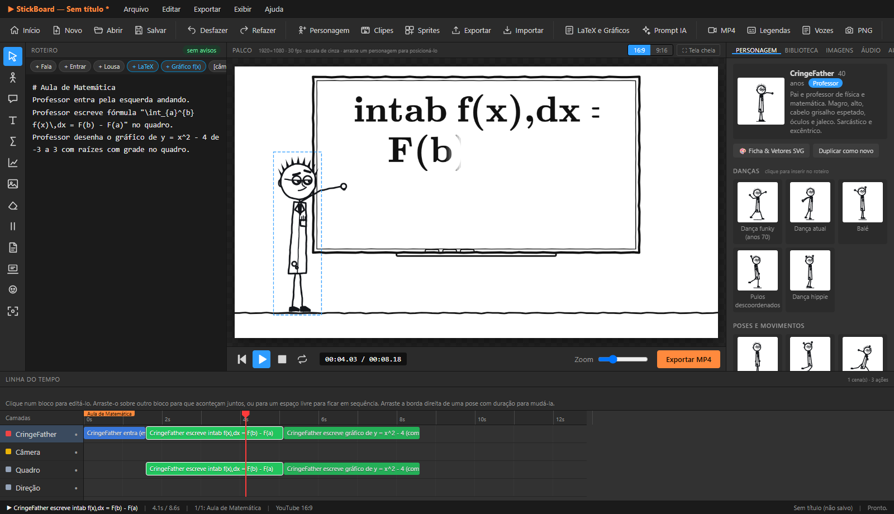
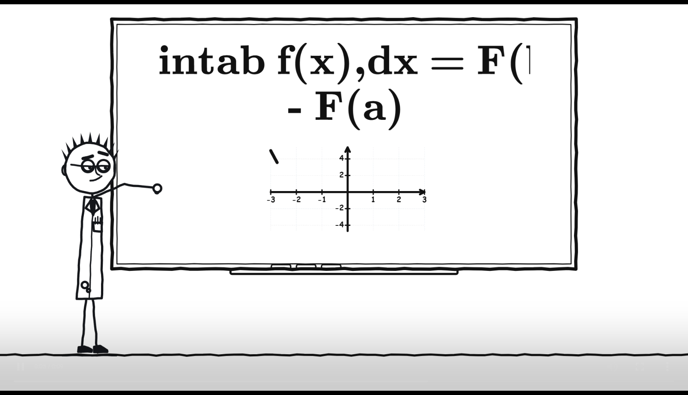
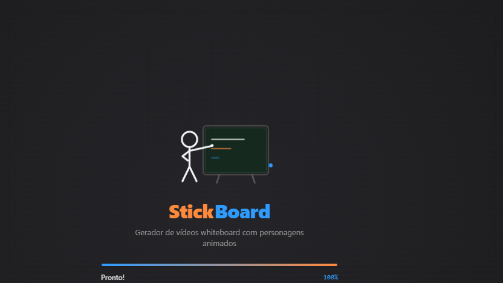
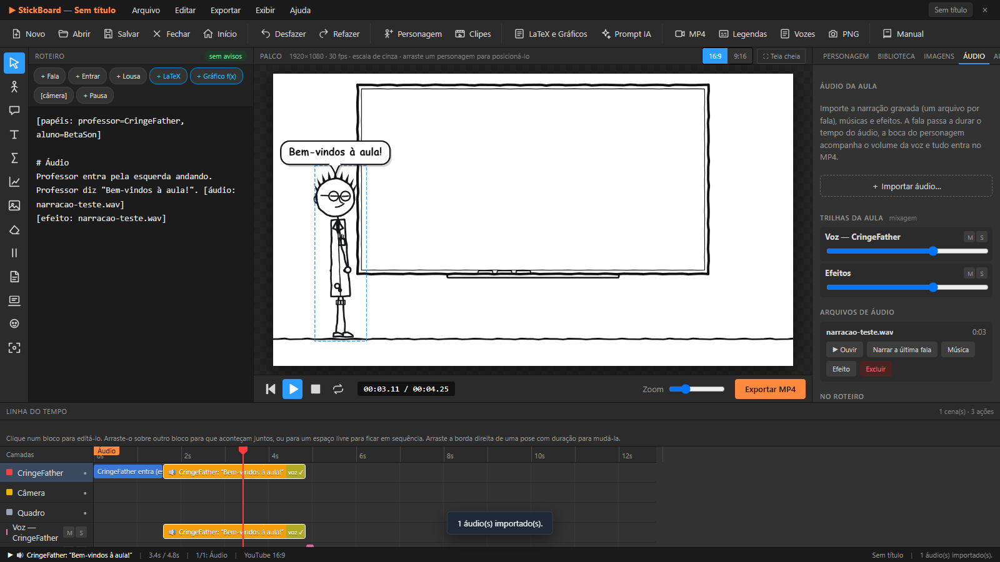
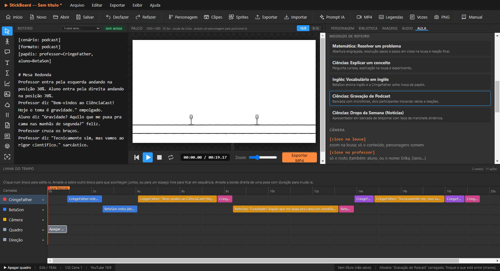
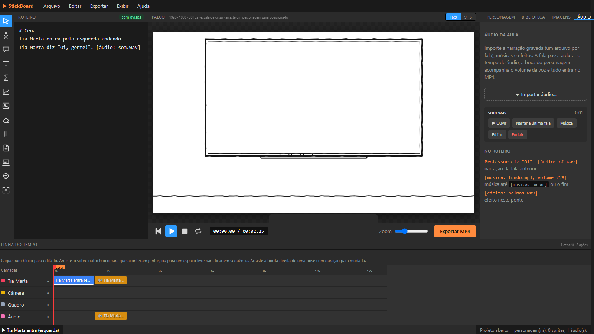
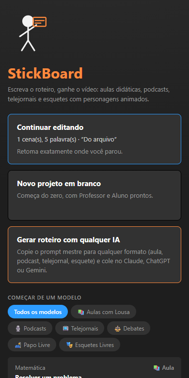

# StickBoard

## Proposta acadêmica de uma ferramenta para criação de videoaulas animadas

O **StickBoard** é uma aplicação de autoria que permite a professores e estudantes transformar roteiros em vídeos explicativos com personagens animados, lousa, recursos visuais e áudio. A proposta é reunir, em um mesmo ambiente, a escrita do roteiro, a organização das cenas e a produção do vídeo, reduzindo a necessidade de alternar entre ferramentas independentes.

> **Área de aplicação:** tecnologias educacionais, produção de recursos didáticos digitais e autoria multimídia.<br>
> **Plataformas:** Windows (aplicativo desktop), Android e navegador para desenvolvimento e demonstração.

## Resumo

A produção de videoaulas costuma envolver etapas separadas de planejamento, gravação, edição e geração de materiais visuais. Esse processo pode exigir ferramentas especializadas e conhecimentos técnicos que dificultam a criação de conteúdos curtos e personalizados. O StickBoard propõe uma alternativa de autoria baseada em roteiro: o usuário descreve falas e ações em português, organiza os eventos em uma linha do tempo e acompanha a animação em um palco de pré-visualização. O sistema oferece personagens personalizáveis, lousa para textos, fórmulas, gráficos e imagens, trilhas de áudio e exportação de vídeos e materiais complementares. Este repositório documenta a proposta e sua implementação atual; não apresenta uma avaliação experimental de aprendizagem ou resultados de eficácia pedagógica.

**Palavras-chave:** tecnologia educacional; videoaula; autoria multimídia; animação; roteiro.

## Contexto e justificativa

Vídeos explicativos podem combinar fala, texto, ilustração e demonstração visual. Criá-los, porém, envolve coordenar esses elementos no tempo e preparar recursos em diferentes programas. O StickBoard busca simplificar esse trabalho por meio de um fluxo integrado e de uma linguagem de roteiro legível, com pré-visualização das ações antes da exportação.

A ferramenta foi concebida para apoiar a **produção do material didático**, e não para substituir o planejamento pedagógico, o professor, um ambiente virtual de aprendizagem ou a avaliação dos estudantes. O conteúdo e a adequação didática permanecem sob responsabilidade de quem produz a aula.

## Objetivos

### Objetivo geral

Desenvolver uma aplicação multiplataforma para autoria de vídeos didáticos animados a partir de roteiros, reunindo recursos de animação, composição visual, áudio e exportação.

### Objetivos específicos

- Permitir descrever cenas, falas e ações por meio de comandos em português.
- Oferecer personagens animados e ferramentas para compor sua participação nas cenas.
- Integrar uma lousa para conteúdo textual, matemático, gráfico e imagético.
- Organizar e revisar a sequência audiovisual com pré-visualização e linha do tempo.
- Gerar vídeos em formatos usuais e arquivos auxiliares para reutilização.
- Manter o fluxo principal disponível em desktop e Android, com suporte a uso local.

## Público e cenários de uso

- **Docentes e equipes pedagógicas:** elaboração de explicações, revisões e materiais de apoio.
- **Estudantes e grupos de projeto:** criação de apresentações animadas e demonstrações de conceitos.
- **Instituições e projetos de extensão:** produção de conteúdos curtos para atividades presenciais ou digitais.
- **Criadores de conteúdo educacional:** prototipagem de cenas e vídeos para diferentes canais.

Exemplos de aplicação incluem uma explicação matemática com fórmula e gráfico na lousa, uma conversa encenada entre personagens, uma apresentação em formato de podcast e um vídeo vertical para dispositivos móveis.

## Fluxo de produção

1. **Iniciar:** criar um roteiro em branco ou partir de um modelo.
2. **Escrever:** descrever falas, entradas, movimentos, expressões, pausas e conteúdo da lousa.
3. **Compor:** escolher personagens e cenários, ajustar a posição dos elementos e incluir imagens e áudio.
4. **Revisar:** reproduzir a cena no palco, inspecionar eventos na linha do tempo e corrigir avisos do roteiro.
5. **Exportar:** gerar o vídeo e, conforme a necessidade, um quadro em imagem, legendas ou roteiro de gravação.

## Funcionalidades

| Recurso | O que permite fazer |
|---|---|
| **Roteiro em português** | Descrever cenas, diálogos, movimentos, poses, emoções, pausas e ações simultâneas. O editor interpreta o texto e sinaliza comandos não reconhecidos. |
| **Personagens e elenco** | Usar personagens incluídos no sistema ou criar personagens, editar fichas, expressões, poses e clipes de animação. |
| **Palco e reprodução** | Pré-visualizar a composição, acompanhar a animação e ajustar o posicionamento dos personagens. |
| **Linha do tempo** | Consultar e organizar falas e ações ao longo da cena, localizar eventos e revisar duração e sincronização. |
| **Lousa didática** | Exibir texto e fórmulas LaTeX; inserir gráficos de funções e gráficos de dados para apoiar explicações. |
| **Imagens** | Importar imagens para a lousa, configurar efeitos de entrada e saída e definir sua duração na cena. |
| **Cenários e formatos** | Compor cenas de aula, podcast, telejornal ou formato livre e preparar vídeos horizontais ou verticais. |
| **Áudio** | Associar voz às falas, adicionar música e efeitos e controlar trilhas na edição e na exportação. |
| **Projetos** | Salvar e reabrir projetos compactados, preservando roteiro e recursos associados. |
| **Exportação** | Produzir vídeo MP4, imagem PNG do quadro e legendas SRT; também é possível gerar roteiro de gravação para atores. |
| **Apoio à criação de roteiro** | Gerar um prompt mestre com a sintaxe e os recursos disponíveis para uso opcional em uma IA externa; o roteiro retornado pode ser revisado no aplicativo. |
| **Uso multiplataforma** | Executar como aplicativo Windows ou Android, além de disponibilizar o renderer no navegador para demonstração e desenvolvimento. |

### Exemplo de roteiro

```text
# Produtos notáveis

Professor entra pela esquerda andando.
Professor diz "Hoje vamos aprender uma nova expressão."
Professor escreve $(a+b)^2$ no quadro.
Aluno fica confuso.
Professor desenha o gráfico de y = x^2 - 2 no quadro.
Espera 2 segundos.
```

O roteiro é interpretado pelo sistema para compor a sequência audiovisual. Consulte [Formato do roteiro](docs/ROTEIRO.md) para a sintaxe, exemplos de áudio, imagens, câmera, personagens e comandos simultâneos.

## Galeria de telas

As capturas abaixo estão armazenadas no repositório em [`evidencias/`](evidencias/). Cada imagem é uma evidência visual de uma tela ou recurso da aplicação.

| Tela ou recurso | Captura |
|---|---|
| Tela inicial |  |
| Editor e elenco |  |
| Palco durante a reprodução |  |
| Fórmula e gráfico na lousa |  |
| Quadro de vídeo exportado |  |
| Gráficos |  |
| Áudio |  |
| Cenário de podcast |  |
| Projeto aberto |  |
| Tela inicial em dispositivo móvel |  |

Para consultar mais capturas e o contexto de coleta, veja os relatórios em [`evidencias/`](evidencias/), incluindo [evidências completas](evidencias/48-evidencias-completas-consolidado.md), [revisão geral de funcionalidades](evidencias/55-revisao-geral-funcionalidades-consolidado.md) e [fórmulas e gráficos](evidencias/53-editor-latex-e-graficos-consolidado.md).

## Aspectos técnicos

- **Interface:** React, TypeScript e Vite.
- **Aplicativo desktop:** Electron.
- **Aplicativo Android:** Capacitor.
- **Estado da interface:** Zustand.
- **Renderização e exportação:** canvas 2D e pipeline de geração de vídeo no cliente.
- **Fórmulas:** KaTeX.
- **Testes:** Vitest para o domínio e testes end-to-end com Playwright.

A arquitetura separa o domínio compartilhado, a interface e as integrações de plataforma. O renderer não acessa diretamente APIs do Node; operações de arquivos passam pela camada de plataforma. No Electron, o processo principal e o preload fazem a comunicação com a interface. Consulte [documentação da arquitetura](docs/ARQUITETURA.md).

## Instalação e execução

Requisitos: Node.js e npm. Para o fluxo Android, também são necessários o Android Studio, o SDK Android e um JDK compatível com a configuração local.

```bash
npm install
npm run dev
```

Comandos úteis:

| Comando | Finalidade |
|---|---|
| `npm run dev` | Iniciar o ambiente de desenvolvimento Vite/Electron. |
| `npm run dev:web` | Executar a interface no navegador. |
| `npm test` | Executar os testes unitários do domínio. |
| `npm run typecheck` | Verificar os tipos TypeScript. |
| `npm run check` | Executar verificação de tipos, arquitetura e testes unitários. |
| `npm run build` | Compilar a aplicação. |
| `npm run dist` | Gerar os pacotes desktop Windows. |
| `npm run android:apk` | Sincronizar e compilar o APK Android de depuração. |

## Escopo e possibilidades de avaliação acadêmica

O StickBoard é apresentado como uma ferramenta de autoria. A existência de recursos de edição e exportação não demonstra, por si só, melhoria de aprendizagem, acessibilidade ou redução de tempo de produção. Essas questões exigem avaliação específica com participantes e critérios definidos.

Como continuidade acadêmica, podem ser investigados:

- usabilidade do fluxo de autoria com docentes e estudantes;
- tempo e esforço necessários para produzir uma videoaula;
- compreensão e revisão de roteiros por usuários iniciantes;
- acessibilidade dos vídeos e da interface;
- adequação dos formatos produzidos a diferentes atividades educacionais.

## Documentação relacionada

- [Arquitetura do sistema](docs/ARQUITETURA.md)
- [Formato e comandos do roteiro](docs/ROTEIRO.md)
- [Exemplo de prompt mestre](docs/prompt-mestre-exemplo.md)
- [Relatórios e capturas de evidência](evidencias/)
